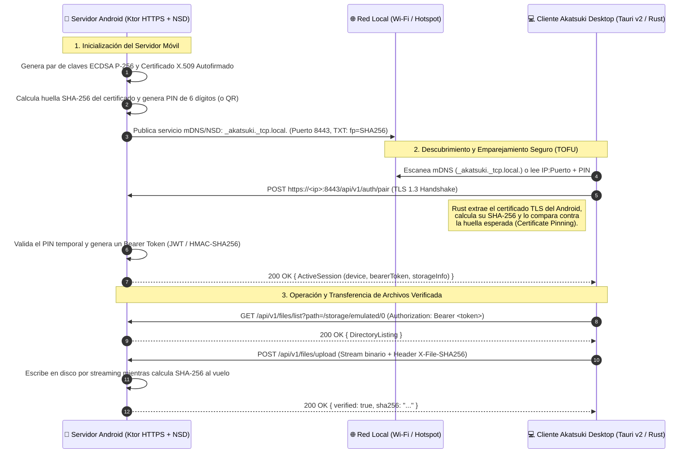

# Especificación Técnica Oficial: Sistema de Diseño "Akatsuki Cyberpunk" y Arquitectura del Servidor Web Android

Este documento constituye la referencia maestra de diseño e ingeniería para el ecosistema **Akatsuki // Shinobi Secure File Transfer**. Define:
1. El **Sistema de Diseño "Akatsuki Cyberpunk"** completo (paleta de colores, fuentes, nombres de estilos, escala tipográfica y su equivalencia para Android / Jetpack Compose).
2. La **Arquitectura de Conexión Segura** entre el cliente de escritorio (**Tauri v2 / Rust**) y el servidor móvil (**Android Web Service**).
3. El **Catálogo Completo de Endpoints REST y Streaming** que debe implementar la aplicación Android para operar al 100% con el cliente de escritorio desarrollado.

---

## Parte 1: Sistema de Diseño "Akatsuki Cyberpunk"

La identidad visual combina los tonos oscuros y carmesí de la organización **Akatsuki** con una estética **Cyberpunk HUD** de alta precisión técnica, bordes poligonales biselados a 45° y telemetría monoespaciada.

### 1.1 Paleta de Colores Oficial

#### A. Fondos y Superficies (`Backgrounds & Surfaces`)
| Nombre del Estilo / Token | Variable CSS | Clase Tailwind | Código Hex / Valor | Equivalente Android (`Color`) | Uso Específico |
| :--- | :--- | :--- | :---: | :---: | :--- |
| **Obsidian Cloak** | `--ak-bg-void` | `bg-akatsuki-void` | `#07070C` | `Color(0xFF07070C)` | Fondo raíz de la aplicación / Lienzo principal. |
| **Shadow Mantle** | `--ak-bg-mantle` | `bg-akatsuki-mantle` | `#0D0E17` | `Color(0xFF0D0E17)` | Header HUD, barra de estado inferior, fondos de inputs y subpaneles. |
| **Tactical Surface** | `--ak-bg-panel` | `bg-akatsuki-panel` | `#141624` | `Color(0xFF141624)` | Contenedores principales de paneles (`CyberPanel`), tarjetas y modales. |
| **Uchiha Slate** | `--ak-bg-elevated` | `bg-akatsuki-elevated` | `#1D2033` | `Color(0xFF1D2033)` | Estado *hover* en filas de archivos, elementos seleccionados e inputs en foco. |
| **Amaterasu Glass** | `--ak-bg-glass` | `bg-akatsuki-glass` | `rgba(20, 22, 36, 0.78)` | `Color(0xC7141624)` | Superficies translúcidas y modales con desenfoque (`backdrop-blur`). |

#### B. Colores de Marca y Acentos Cyberpunk (`Brand & Telemetry Accents`)
| Nombre del Estilo / Token | Variable CSS | Clase Tailwind | Código Hex | Equivalente Android (`Color`) | Uso Específico |
| :--- | :--- | :--- | :---: | :---: | :--- |
| **Akatsuki Crimson** | `--ak-primary` | `bg-akatsuki-primary` / `text-akatsuki-primary` | `#E11D48` | `Color(0xFFE11D48)` | Acción primaria, nubes Akatsuki, barra superior de acento en paneles locales. |
| **Sharingan Neon** | `--ak-primary-glow` | `bg-akatsuki-primary-glow` / `text-akatsuki-primary-glow` | `#FF1E4D` | `Color(0xFFFF1E4D)` | Estado *hover* de botones primarios, bordes iluminados e iconos críticos. |
| **Dried Blood** | `--ak-primary-muted` | `bg-akatsuki-primary-muted` | `#4C0519` | `Color(0xFF4C0519)` | Fondo de filas seleccionadas, insignias carmesí y base de botones destructivos. |
| **Rinnegan Cyber Cyan** | `--ak-cyber-cyan` | `bg-akatsuki-cyan` / `text-akatsuki-cyan` | `#00F0FF` | `Color(0xFF00F0FF)` | Telemetría en tiempo real, panel remoto Android, botones secundarios y mDNS. |
| **Susanoo Violet** | `--ak-cyber-purple` | `bg-akatsuki-purple` / `text-akatsuki-purple` | `#A855F7` | `Color(0xFFA855F7)` | Indicadores criptográficos (`TLS 1.3 Pinning`, verificación `SHA-256`). |
| **Zetsu Bio-Green** | `--ak-status-success` | `bg-akatsuki-success` / `text-akatsuki-success` | `#10B981` | `Color(0xFF10B981)` | Enlace activo con Android, transferencia completada y hash verificado. |
| **Paper Bomb Amber** | `--ak-status-warning` | `bg-akatsuki-warning` / `text-akatsuki-warning` | `#F59E0B` | `Color(0xFFF59E0B)` | Estado sin conexión, espera de confirmación TOFU o archivos comprimidos. |
| **Mangekyo Scarlet** | `--ak-status-danger` | `bg-akatsuki-danger` / `text-akatsuki-danger` | `#FF003C` | `Color(0xFFFF003C)` | Errores de red/integridad, desconexión y cancelación de transferencias. |

#### C. Colores Tipográficos (`Typography Colors`)
| Nombre del Estilo / Token | Variable CSS | Clase Tailwind | Código Hex | Equivalente Android (`Color`) | Uso Específico |
| :--- | :--- | :--- | :---: | :---: | :--- |
| **Cloud White** | `--ak-text-heading` | `text-akatsuki-heading` | `#F8FAFC` | `Color(0xFFF8FAFC)` | Títulos (`H1`, `H2`, `H3`), nombres de carpetas y texto de botones primarios. |
| **Shinobi Silver** | `--ak-text-body` | `text-akatsuki-body` | `#CBD5E1` | `Color(0xFFCBD5E1)` | Cuerpo de texto general y nombres de archivos en el explorador. |
| **Hidden Rain Ash** | `--ak-text-muted` | `text-akatsuki-muted` | `#64748B` | `Color(0xFF64748B)` | Rutas de directorios, fechas de modificación, hashes secundarios y etiquetas. |
| **Crimson Highlight** | `--ak-text-accent` | `text-akatsuki-accent` | `#FB7185` | `Color(0xFFFB7185)` | Subtítulos de sección (`Heading3`), estado del footer e insignias rojas. |
| **Neon Telemetry** | `--ak-text-cyber` | `text-akatsuki-telemetry` | `#67E8F9` | `Color(0xFF67E8F9)` | Direcciones `IP:Puerto`, velocidades `MB/s` y tamaños de archivo (`KB/MB/GB`). |

#### D. Matriz de Estilos para Botones (`CyberButton Variants`)
| Nombre de Variante | Fondo Base | Color de Texto | Borde Poligonal 6 Lados | Estado Hover |
| :--- | :---: | :---: | :---: | :--- |
| **`primary`** | `#E11D48` | `#F8FAFC` | `#FF1E4D` (`1.5px`) | Fondo `#FF1E4D` + Borde `#FF1E4D` |
| **`secondary`** | `#141624` | `#00F0FF` | `rgba(0, 240, 255, 0.45)` | Fondo `rgba(0, 240, 255, 0.15)` + Borde `#00F0FF` |
| **`ghost`** | `transparent` | `#CBD5E1` | `transparent` | Fondo `#1D2033` + Texto `#F8FAFC` + Borde `rgba(255,255,255,0.28)` |
| **`danger`** | `#4C0519` | `#FB7185` | `#E11D48` (`1.5px`) | Fondo `#FF003C` + Texto `#F8FAFC` + Borde `#FF1E4D` |

---

### 1.2 Fuentes y Escala Tipográfica

#### Familias Tipográficas Definidas
1. **Display / Táctica (`--font-display` / `font-display`):** `'Orbitron'`, `'Rajdhani'`, `sans-serif`.
   - *Propósito:* Encabezados principales, títulos de paneles, botones e indicadores HUD.
2. **Interfaz y Listas (`--font-sans` / `font-sans`):** `'Plus Jakarta Sans'`, `system-ui`, `sans-serif`.
   - *Propósito:* Lectura de alta densidad en exploradores de archivos, formularios y descripciones.
3. **Telemetría y Criptografía (`--font-mono` / `font-mono`):** `'JetBrains Mono'`, `monospace`.
   - *Propósito:* Endpoints `https://IP:Puerto`, pesos en bytes, velocidades de flujo y hashes `SHA-256`.

#### Especificación de Estilos y Tamaños de Fuente

| Nombre del Estilo (Tailwind) | Componente React | Fuente | Tamaño (`rem`) | Tamaño (`px` / Android `sp`) | Peso (`font-weight`) | Interlineado (`line-height`) | Espaciado (`letter-spacing`) | Transformación |
| :--- | :--- | :--- | :---: | :---: | :---: | :---: | :---: | :---: |
| **`text-display-xl`** | `<DisplayXL />` | `Orbitron` | `2.0rem` | `32px` / `32.sp` | `700` (Bold) | `1.15` | `0.08em` | `UPPERCASE` |
| **`text-heading-1`** | `<Heading1 />` | `Orbitron` | `1.375rem` | `22px` / `22.sp` | `700` (Bold) | `1.25` | `0.06em` | `UPPERCASE` |
| **`text-heading-2`** | `<Heading2 />` | `Orbitron` / `Rajdhani` | `1.125rem` | `18px` / `18.sp` | `600` (SemiBold) | `1.30` | `0.05em` | `UPPERCASE` |
| **`text-heading-3`** | `<Heading3 />` | `Rajdhani` | `0.9375rem` | `15px` / `15.sp` | `600` (SemiBold) | `1.40` | `0.04em` | `UPPERCASE` |
| **`text-body-md`** | `<BodyText />` | `Plus Jakarta Sans` | `0.875rem` | `14px` / `14.sp` | `400` (Regular) | `1.50` | `0em` | Normal |
| **`text-list-item`** | `<ListItemText />` | `Plus Jakarta Sans` | `0.8125rem` | `13px` / `13.sp` | `500` (Medium) | `1.40` | `0.01em` | Normal |
| **`text-list-header`** | Cabeceras de Tabla | `Rajdhani` | `0.75rem` | `12px` / `12.sp` | `700` (Bold) | `1.20` | `0.08em` | `UPPERCASE` |
| **`text-button-md`** | `<CyberButton size="md"/>` | `Rajdhani` | `0.875rem` | `14px` / `14.sp` | `700` (Bold) | `1.00` | `0.06em` | `UPPERCASE` |
| **`text-button-sm`** | `<CyberButton size="sm"/>` | `Rajdhani` | `0.75rem` | `12px` / `12.sp` | `600` (SemiBold) | `1.00` | `0.05em` | `UPPERCASE` |
| **`text-mono-data`** | `<MonoTelemetry />` | `JetBrains Mono` | `0.75rem` | `12px` / `12.sp` | `500` (Medium) | `1.40` | `-0.01em` | Normal |
| **`text-mono-hash`** | `<MonoHash />` | `JetBrains Mono` | `0.6875rem` | `11px` / `11.sp` | `400` (Regular) | `1.35` | `0em` | Normal |

---

### 1.3 Geometría de Bordes Poligonales HUD (`.cyber-chamfer-*`)

Para evitar que los recortes a 45° pierdan el borde de color al usar `clip-path`, el sistema implementa un polígono continuo de 6 lados (`1.5px` de grosor constante en rectas y diagonales):
- **`.cyber-chamfer-sm`**: Recorte de `9px` en la esquina superior derecha e inferior izquierda (usado en botones, tarjetas de dispositivos e indicadores tácticos).
- **`.cyber-chamfer-md`**: Recorte de `14px` en la esquina superior derecha e inferior izquierda (usado en paneles principales `CyberPanel` y modales).
- **En Android (Jetpack Compose):** Se replica creando un `Shape` personalizado con `GenericShape { size, _ -> ... }` que trace exactamente los mismos 6 vértices con `drawOutline` de `1.5.dp`.

---

## Parte 2: Arquitectura de Conexión Segura (PC Cliente ⇄ Android Servidor)

En esta arquitectura **el dispositivo Android actúa como el Servidor Web (`HTTPS Server`)** y **la aplicación de escritorio (`akatsuki-desktop`) actúa como el Cliente**.



### 2.1 Las 4 Capas de Seguridad para el Desarrollo en Android

1. **Capa 1 — Transporte Cifrado TLS 1.3 con Certificado Autofirmado Dinámico:**
   - Como el teléfono Android opera en una IP privada (`192.168.x.x`), no puede usar certificados públicos de Let's Encrypt.
   - Al instalarse o iniciarse por primera vez, la app Android genera un certificado **X.509 ECDSA (P-256)** con validez de 10 años almacenado en su almacenamiento privado (`KeyStore`).
   - El servidor embebido en Android (recomendado: **Ktor Server con motor CIO o Netty**) se levanta exclusivamente sobre **HTTPS** (puerto por defecto `8443`).

2. **Capa 2 — Certificate Pinning bajo modelo TOFU (Trust On First Use):**
   - La app Android calcula el hash `SHA-256` del certificado en formato DER (representado en hexadecimal separado por dos puntos: `9F:86:D0:...`).
   - Esta huella se incluye en el código QR de emparejamiento y en el registro mDNS.
   - El cliente Rust (`src-tauri/src/infrastructure/tls_verifier.rs`) verifica que el certificado presentado en el handshake TLS coincida exactamente con esa huella `SHA-256`, impidiendo ataques *Man-in-the-Middle (MitM)* en redes Wi-Fi compartidas.

3. **Capa 3 — Autenticación de Sesión mediante PIN Efímero + Token Bearer:**
   - La app Android genera un **PIN numérico de 6 dígitos** que rota cada 5 minutos o al solicitar un nuevo emparejamiento.
   - El cliente PC envía ese PIN en `POST /api/v1/auth/pair`. Si es válido, Android responde con un `bearerToken` criptográfico de sesión (válido mientras el servicio esté activo o durante 24h).
   - **Todos** los endpoints posteriores (`/files/*`, `/device/*`) exigen la cabecera `Authorization: Bearer <token>`. Si falta o es inválido, Android responde `401 Unauthorized`.

4. **Capa 4 — Integridad de Archivos End-to-End (`SHA-256` en Streaming) y Prevención de *Path Traversal*:**
   - **Integridad:** En cada subida o descarga se calcula el hash `SHA-256` leyendo el flujo en bloques de `64 KB`. Si el hash calculado al finalizar no coincide con el enviado en la cabecera `X-File-SHA256`, el archivo temporal se elimina inmediatamente y se reporta error de integridad.
   - **Seguridad de Rutas en Android (*Path Traversal Protection*):** El servidor Android debe normalizar toda ruta recibida (`File(baseDir, requestedPath).canonicalPath`) y verificar que comience con `/storage/emulated/0` (o los volúmenes autorizados), rechazando cualquier intento de usar `../` con `403 Forbidden`.

---

## Parte 3: Especificación de Endpoints del Servidor Web Android

Todos los endpoints usan prefijo `/api/v1`, codificación `UTF-8` y formato JSON (salvo las transferencias binarias de archivos). Los nombres de las propiedades JSON están en **`camelCase`** para coincidir exactamente con los modelos de Rust (`#[serde(rename_all = "camelCase")]`) y TypeScript del cliente `akatsuki-desktop`.

### Resumen de Endpoints a Implementar en Android

| Método | Endpoint | Autenticación | Propósito |
| :---: | :--- | :---: | :--- |
| `GET` | `/api/v1/health` | Pública | Descubrimiento, estado del servidor y huella del certificado TLS. |
| `POST` | `/api/v1/auth/pair` | PIN de 6 dígitos | Emparejamiento inicial y obtención de `ActiveSession` + `bearerToken`. |
| `POST` | `/api/v1/auth/revoke` | `Bearer Token` | Cerrar sesión y revocar el token actual desde el cliente PC. |
| `GET` | `/api/v1/device/storage` | `Bearer Token` | Consultar espacio total/libre actualizado del dispositivo Android. |
| `GET` | `/api/v1/files/list` | `Bearer Token` | Listar archivos y carpetas de una ruta específica en Android. |
| `POST` | `/api/v1/files/mkdir` | `Bearer Token` | Crear una nueva carpeta en el almacenamiento de Android. |
| `DELETE`| `/api/v1/files/delete` | `Bearer Token` | Eliminar un archivo o directorio en Android. |
| `GET` | `/api/v1/files/download`| `Bearer Token` | **Transferencia Android → PC** (Streaming binario + `X-File-SHA256`). |
| `POST` | `/api/v1/files/upload` | `Bearer Token` | **Transferencia PC → Android** (Streaming binario/multipart + `SHA-256`). |

---

### 3.1 `GET /api/v1/health`
Permite al cliente verificar que el servidor Android está activo antes o durante el escaneo de red.

- **Respuesta Exitosa (`200 OK`):**
```json
{
  "status": "online",
  "deviceId": "ak-node-android-01",
  "deviceName": "NOTHING PHONE (2) // ITACHI",
  "model": "Android 15 • Akatsuki WebService v1.0",
  "port": 8443,
  "tlsCertFingerprintSha256": "9F:86:D0:81:88:4C:7D:65:9A:2F:EA:A0:C5:5A:D0:15:A3:BF:4F:1B:2B:0B:82:2C:D1:5D:6C:15:B0:F0:0A:08"
}
```

---

### 3.2 `POST /api/v1/auth/pair`
Valida el PIN mostrado en la pantalla del celular Android (o leído del QR) y devuelve la estructura `ActiveSession` que consume directamente el comando `pair_android_device` de nuestro cliente.

- **Request Body (`application/json`):**
```json
{
  "clientName": "Akatsuki Desktop (hack4u)",
  "pinCode": "749201"
}
```

- **Respuesta Exitosa (`200 OK`):**
```json
{
  "device": {
    "deviceId": "ak-node-android-01",
    "deviceName": "NOTHING PHONE (2) // ITACHI",
    "model": "Android 15",
    "ipAddress": "192.168.1.88",
    "port": 8443,
    "tlsCertFingerprintSha256": "9F:86:D0:81:88:4C:7D:65:9A:2F:EA:A0:C5:5A:D0:15:A3:BF:4F:1B:2B:0B:82:2C:D1:5D:6C:15:B0:F0:0A:08",
    "discoveredVia": "https-tofu",
    "paired": true
  },
  "bearerToken": "eyJhbGciOiJIUzI1NiIsInR5cCI6IkpXVCJ9...",
  "connectedAt": "2026-11-12T22:00:00Z",
  "androidStorageTotalBytes": 274877906944,
  "androidStorageFreeBytes": 158913789952
}
```
- **Errores Posibles:**
  - `401 Unauthorized`: PIN incorrecto o expirado.
  - `429 Too Many Requests`: Más de 5 intentos fallidos de PIN (bloqueo temporal de 60 segundos).

---

### 3.3 `GET /api/v1/files/list`
Lista el contenido de un directorio dentro del almacenamiento del teléfono Android. Consumido por `fetch_android_directory` en `src-tauri/src/infrastructure/android_client.rs`.

- **Headers Requeridos:**
  - `Authorization: Bearer <bearerToken>`
- **Query Parameters:**
  - `path` (string, requerido): Ruta absoluta en Android, por ejemplo `/storage/emulated/0` o `/storage/emulated/0/Download`.
- **Respuesta Exitosa (`200 OK`):**
```json
{
  "currentPath": "/storage/emulated/0/Download",
  "hostname": null,
  "entries": [
    {
      "name": "Reportes",
      "path": "/storage/emulated/0/Download/Reportes",
      "isDir": true,
      "sizeBytes": 0,
      "modifiedAt": "2026-11-12 19:45",
      "extension": null
    },
    {
      "name": "VID_20261112_4K60.mp4",
      "path": "/storage/emulated/0/Download/VID_20261112_4K60.mp4",
      "isDir": false,
      "sizeBytes": 412876800,
      "modifiedAt": "2026-11-12 20:05",
      "extension": "mp4"
    }
  ]
}
```

---

### 3.4 `GET /api/v1/files/download` (Transferencia Android → PC)
Transfiere un archivo desde el celular Android hacia la computadora mediante streaming binario continuo.

- **Headers Requeridos:**
  - `Authorization: Bearer <bearerToken>`
  - `Range: bytes=0-` *(Opcional, para reanudación de descargas grandes)*
- **Query Parameters:**
  - `path` (string, requerido): Ruta absoluta del archivo en el dispositivo Android (ej. `/storage/emulated/0/DCIM/Camera/VID_01.mp4`).
- **Headers de Respuesta (`200 OK` / `206 Partial Content`):**
  - `Content-Type: application/octet-stream`
  - `Content-Length: <sizeBytes>`
  - `Content-Disposition: attachment; filename="VID_01.mp4"`
  - `X-File-SHA256: <hash_sha256_en_minusculas>` *(Calculado por Android para que el PC verifique la integridad al terminar de escribir en disco)*
- **Body de Respuesta:** Flujo binario directo (`OutputStream` en bloques de 64 KB).

---

### 3.5 `POST /api/v1/files/upload` (Transferencia PC → Android)
Recibe un archivo enviado desde la computadora y lo almacena en el directorio destino de Android verificando su suma `SHA-256`.

- **Headers Requeridos:**
  - `Authorization: Bearer <bearerToken>`
  - `Content-Type: application/octet-stream` *(o `multipart/form-data`)*
  - `X-Destination-Path: /storage/emulated/0/Download/archivo.zip` *(Codificado en URL si contiene caracteres especiales)*
  - `X-Expected-SHA256: e3b0c44298fc1c149afbf4c8996fb92427ae41e4649b934ca495991b7852b855`
  - `Content-Length: <totalBytes>`
- **Comportamiento en el Servidor Android:**
  1. Escribe el stream entrante en un archivo temporal `.part` dentro del directorio destino mientras alimenta un `MessageDigest.getInstance("SHA-256")`.
  2. Al finalizar el stream, compara el hash calculado con `X-Expected-SHA256`.
  3. Si coinciden, renombra el archivo `.part` a su nombre final y responde `200 OK`. Si no coinciden, borra el archivo `.part` y responde `422 Unprocessable Entity`.
- **Respuesta Exitosa (`200 OK`):**
```json
{
  "verified": true,
  "savedPath": "/storage/emulated/0/Download/archivo.zip",
  "sizeBytes": 684510200,
  "sha256": "e3b0c44298fc1c149afbf4c8996fb92427ae41e4649b934ca495991b7852b855"
}
```

---

### 3.6 `POST /api/v1/files/mkdir` y `DELETE /api/v1/files/delete`
Endpoints complementarios de gestión de archivos en Android:

- **Crear Carpeta (`POST /api/v1/files/mkdir`):**
  - Request: `{ "path": "/storage/emulated/0/Download/NuevaCarpeta" }`
  - Response (`201 Created`): `{ "created": true, "path": "/storage/emulated/0/Download/NuevaCarpeta" }`
- **Eliminar Archivo/Carpeta (`DELETE /api/v1/files/delete`):**
  - Request: `{ "path": "/storage/emulated/0/Download/temp.mp4" }`
  - Response (`200 OK`): `{ "deleted": true, "path": "/storage/emulated/0/Download/temp.mp4" }`

---

### 3.7 `GET /api/v1/device/storage` y `POST /api/v1/auth/revoke`
- **Estado de Almacenamiento (`GET /api/v1/device/storage`):**
  - Response (`200 OK`):
    ```json
    {
      "androidStorageTotalBytes": 274877906944,
      "androidStorageFreeBytes": 158913789952
    }
    ```
- **Revocar Sesión (`POST /api/v1/auth/revoke`):**
  - Invalida inmediatamente el `bearerToken` en memoria del servidor Android y responde `200 OK` `{ "revoked": true }`.

---

## Parte 4: Guía de Implementación Recomendada para Android (Kotlin)

Para cuando inicies el desarrollo del proyecto móvil en Android Studio, esta es la pila tecnológica exacta recomendada para levantar el servidor web compatible con `akatsuki-desktop`:

1. **Servidor HTTP/HTTPS Embebido en Android:**
   - `io.ktor:ktor-server-core` + `io.ktor:ktor-server-netty` (o `cio`) + `io.ktor:ktor-network-tls-certificates` + `io.ktor:ktor-server-content-negotiation` + `io.ktor:ktor-serialization-kotlinx-json`.
2. **Ejecución en Segundo Plano:**
   - Ejecutar el servidor Ktor dentro de un **`ForegroundService`** de Android (`specialUse` / `dataSync` / `connectedDevice`) con una notificación persistente estilo Akatsuki que muestre la IP local, el PIN activo y un botón para apagar el Web Service, evitando que Android mate el proceso durante transferencias grandes con la pantalla apagada.
3. **Permisos en `AndroidManifest.xml`:**
   - `INTERNET`, `ACCESS_WIFI_STATE`, `CHANGE_WIFI_MULTICAST_STATE` (para mDNS/NSD), `FOREGROUND_SERVICE` y `MANAGE_EXTERNAL_STORAGE` (Android 11+ para acceso completo a `/storage/emulated/0`).
4. **Publicación mDNS con `NsdManager`:**
   - Registrar un `NsdServiceInfo` con `serviceName = "AkatsukiNode"`, `serviceType = "_akatsuki._tcp."`, `port = 8443` y atributo `setAttribute("fp", certFingerprintSha256)`.
