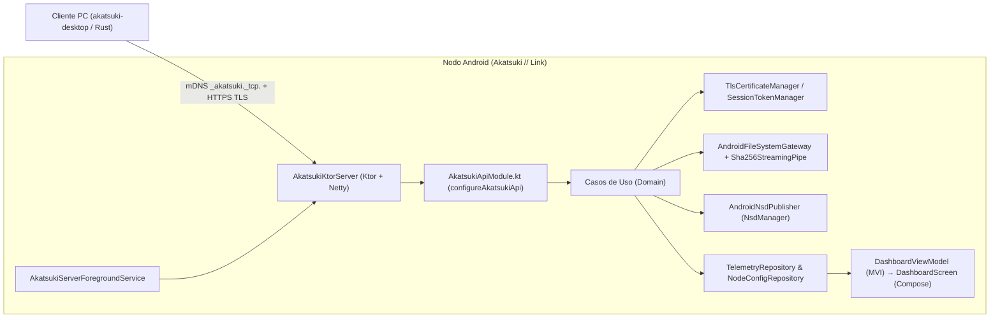

<p align="center">
  
</p>

<h1 align="center">Akatsuki // Link (Android Node)</h1>

<p align="center">
  <strong>Servidor web HTTPS embebido para Android orientado a la transferencia segura de archivos en red local.</strong><br/>
  Nodo móvil oficial del ecosistema <em>Akatsuki // Shinobi Secure File Transfer</em>, diseñado para operar junto al cliente de escritorio <code>akatsuki-desktop</code> (Tauri v2 / Rust).
</p>

---

## 1. Descripción del Proyecto

**Akatsuki // Link** (`com.akatsuki.android`) convierte un dispositivo Android en un nodo servidor **HTTPS** autónomo dentro de la red local (Wi-Fi / Hotspot / USB Tethering), permitiendo explorar el almacenamiento del teléfono y transferir archivos de gran tamaño hacia y desde una PC sin depender de cables USB/MTP ni servidores externos en la nube.

### Capacidades Clave
- **Servidor HTTPS Embebido:** Motor **Ktor + Netty** ejecutándose en el puerto configurable `8443` dentro de un `ForegroundService` (`dataSync`) con `PARTIAL_WAKE_LOCK` para transferencias prolongadas con la pantalla apagada.
- **Descubrimiento Automático mDNS/NSD:** Publicación en LAN del servicio `_akatsuki._tcp.` (`AkatsukiNode`) con registro TXT de huella criptográfica (`fp`) e identificador del nodo (`id`).
- **Seguridad en 4 Capas:** Transporte TLS con certificado X.509 autofirmado, *Certificate Pinning* bajo modelo **TOFU** (*Trust On First Use*), autenticación por PIN efímero + JWT HMAC-SHA256, verificación de integridad **SHA-256 en streaming** y defensa contra *Path Traversal*.
- **HUD Táctico "Akatsuki Cyberpunk":** Interfaz nativa en **Jetpack Compose** con patrón MVI, generación de código QR de emparejamiento, telemetría de flujo en tiempo real, gestor de sesiones activas, explorador local y bitácora de auditoría.

### Stack Tecnológico
| Categoría | Tecnología / Versión |
| :--- | :--- |
| **Lenguaje y SDK** | Kotlin `2.2.10` • Android Min SDK `33` (Android 13) • Target/Compile SDK `37` • Java `17` |
| **UI & Design System** | Jetpack Compose (BOM `2025.02.00`) • Material 3 • Google Fonts (`Orbitron`, `Rajdhani`, `Plus Jakarta Sans`, `JetBrains Mono`) |
| **Servidor Embebido** | Ktor Server `3.1.1` (Netty, TLS Certificates, Content Negotiation, Partial Content, AutoHeadResponse, StatusPages, CORS) |
| **Criptografía & QR** | BouncyCastle `1.80` (`bcpkix-jdk18on`, `bcprov-jdk18on`) • ZXing Core `3.5.3` |
| **Persistencia y Concurrencia** | Kotlin Coroutines `1.10.1` • Kotlinx Serialization `1.8.0` • AndroidX DataStore Preferences `1.1.2` |

---

## 2. Arquitectura

El proyecto sigue **Clean Architecture** combinada con **MVI** en la capa de presentación e inyección de dependencias manual modular mediante `AppContainer`.



### Estructura de Capas (`app/src/main/java/com/akatsuki/android/`)

| Capa | Paquetes / Módulos | Responsabilidad |
| :--- | :--- | :--- |
| **Presentation** | `presentation/splash/`, `presentation/dashboard/` | `AkatsukiSplashScreen` y centro de mando `DashboardScreen` con contrato MVI (`HudUiState`, `HudIntent`, `DashboardViewModel`). |
| **Design System** | `core/designsystem/` | Paleta (`AkatsukiPalette`), tipografía (`AkatsukiTypographyScale`), bordes biselados de 6 lados a 45° (`CyberChamferShape`) y componentes (`CyberPanel`, `CyberButton`, `CyberQrCodeView`). |
| **Domain** | `domain/model/`, `domain/repository/`, `domain/usecase/` | Entidades (`ActiveSession`, `TransferTelemetryItem`, `ServerLifecycleState`), excepciones mapeadas a HTTP (`AkatsukiDomainException`), contratos e implementación de `ManagePinAndPairingUseCase`, `FileOperationsUseCases` y `ValidatePathSecurityUseCase`. |
| **Data** | `data/repository/` | `InMemoryTelemetryRepository` (flujos reactivos de estado del servidor, transferencias y bitácora) y `NodeConfigDataStoreRepository` (persistencia de `deviceId`, `deviceName` y `port` en DataStore). |
| **Infrastructure** | `infrastructure/http/`, `crypto/`, `network/`, `storage/`, `service/` | Implementación de endpoints Ktor, KeyStore PKCS12 (`ECDSA P-256` / fallback `RSA-2048`), tokens JWT HS256, publicación mDNS (`MulticastLock`), streaming 64 KB con `.part` y `ForegroundService`. |
| **DI** | `di/AppContainer.kt`, `AkatsukiApplication.kt` | Grafo de dependencias inicializado en el arranque de la aplicación. |

### Modelo de Seguridad en 4 Capas

1. **Transporte Cifrado TLS (`TlsCertificateManager`):** Genera y persiste en un KeyStore PKCS12 privado (`akatsuki_node_tls.p12`) un certificado X.509 v3 autofirmado con validez de 10 años (`ECDSA P-256` o `RSA-2048` como respaldo).
2. **Certificate Pinning TOFU:** Expone la huella `SHA-256` del certificado DER (`XX:XX:...`) en `/api/v1/health`, en los atributos TXT de mDNS (`fp`) y dentro del código QR para prevenir ataques *Man-in-the-Middle*.
3. **PIN Efímero + Sesión Bearer (`SessionTokenManager`):** PIN numérico de 6 dígitos con vigencia de 5 minutos (rotación automática o manual). Tras 5 intentos fallidos consecutivos aplica un bloqueo de 60 segundos (`429 Too Many Requests`). Al validar el PIN emite un JWT firmado con `HMAC-SHA256` válido por 24 horas.
4. **Integridad SHA-256 y Confinamiento de Rutas:**
   - **Streaming Verificado (`Sha256StreamingPipe`):** Lectura y escritura en bloques de `64 KB`. Las subidas se escriben primero en un archivo temporal `.part`; si el `SHA-256` calculado no coincide con `X-Expected-SHA256`, el `.part` se elimina y el servidor responde `422 Unprocessable Entity`.
   - **Anti-Path Traversal (`ValidatePathSecurityUseCase`):** Canoniza todas las rutas, bloquea secuencias `..` o bytes nulos y restringe el acceso exclusivamente al almacenamiento autorizado (`/storage/emulated/0`), devolviendo `403 Forbidden` ante accesos indebidos.

### Catálogo de Endpoints REST y Streaming (`/api/v1`)

| Método | Endpoint | Auth | Descripción |
| :---: | :--- | :---: | :--- |
| `GET` | `/api/v1/health` | Pública | Estado del nodo, puerto y huella SHA-256 del certificado TLS. |
| `POST` | `/api/v1/auth/pair` | PIN 6 dígitos | Valida el PIN y devuelve `ActiveSession` con `bearerToken`. |
| `POST` | `/api/v1/auth/revoke` | Bearer | Revoca inmediatamente la sesión actual. |
| `GET` | `/api/v1/device/storage` | Bearer | Métricas de espacio total y libre del almacenamiento Android. |
| `GET` | `/api/v1/files/list` | Bearer | Lista archivos y directorios (`path` opcional; defecto `/storage/emulated/0`). |
| `POST` | `/api/v1/files/mkdir` | Bearer | Crea un directorio (`201 Created`). |
| `DELETE` | `/api/v1/files/delete` | Bearer | Elimina un archivo o carpeta recursivamente (por query `path` o body JSON). |
| `GET` | `/api/v1/files/download` | Bearer | Descarga Android → PC por streaming con `X-File-SHA256` y soporte `Range` (`206 Partial Content`). |
| `POST` | `/api/v1/files/upload` | Bearer | Subida PC → Android (`octet-stream` o `multipart/form-data`) con `.part` atómico y verificación `SHA-256`. |

---

## 3. Casos de Uso

1. **Emparejamiento Rápido y Seguro en Red Local (TOFU):**
   El usuario inicia el nodo desde el botón `INICIAR LINK` del HUD (o verifica que el permiso `MANAGE_EXTERNAL_STORAGE` esté concedido). El cliente de escritorio descubre el teléfono vía mDNS (`_akatsuki._tcp.`) o escanea el código **QR TOFU** (que contiene `deviceId`, `deviceName`, `ipAddress`, `port`, `pinCode` y `tlsCertFingerprintSha256`), verifica la huella TLS y obtiene un `bearerToken` de sesión.
2. **Transferencia de Archivos Grandes con Verificación Criptográfica:**
   - *PC → Android:* El cliente envía archivos multimedia o paquetes pesados mediante `POST /api/v1/files/upload` con `X-Destination-Path` y `X-Expected-SHA256`. El teléfono escribe por streaming de 64 KB validando el hash al vuelo y muestra velocidad (`MB/s`), progreso y estado en la pestaña **FLUJO**.
   - *Android → PC:* El cliente solicita `GET /api/v1/files/download` pudiendo reanudar descargas interrumpidas mediante cabeceras `Range: bytes=start-end` y comprobando la integridad con `X-File-SHA256`.
3. **Exploración y Administración Remota del Almacenamiento:**
   Desde el cliente PC se navega por `/storage/emulated/0`, se crean carpetas de destino (`mkdir`), se limpian archivos temporales (`delete`) y se monitorea la cuota disponible (`/device/storage`), mientras el teléfono ofrece una vista local de respaldo en la pestaña **ARCHIVOS**.
4. **Operación Continua en Segundo Plano y Control desde Notificación:**
   Al ejecutarse sobre `AkatsukiServerForegroundService`, las transferencias continúan estables con la pantalla bloqueada. Desde la notificación persistente el usuario puede visualizar el endpoint activo, consultar el PIN vigente, ejecutar **ROTAR PIN** o detener el servicio (**APAGAR WEB SERVICE**).
5. **Control de Acceso, Auditoría y Rotación de Credenciales:**
   En las pestañas **PC** y **LOGS** el propietario del dispositivo visualiza los clientes conectados, revoca sesiones individuales o todas a la vez, inspecciona intentos fallidos o eventos TLS, personaliza el alias y puerto (`CFG`) y puede invalidar la confianza criptográfica regenerando el certificado X.509 (`REGENERAR X.509`).

---

## 4. Compilación, Pruebas y Referencias

### Requisitos y Permisos en Android
- **Android 13+ (`minSdk = 33`)** en la misma red local que el cliente de escritorio.
- Permiso de acceso completo a archivos (`MANAGE_EXTERNAL_STORAGE`) para exponer `/storage/emulated/0` y permiso de notificaciones (`POST_NOTIFICATIONS`) para el control del `ForegroundService`.

### Comandos Gradle
```bash
# Compilar APK de depuración
./gradlew assembleDebug

# Ejecutar pruebas unitarias JVM (endpoints Ktor, crypto, Path Traversal y streaming SHA-256)
./gradlew testDebugUnitTest
```

### Suite de Pruebas Unitarias (`app/src/test/java/com/akatsuki/android/`)
- `AkatsukiKtorEndpointsTest.kt`: Ciclo integral de los 9 endpoints REST/Streaming, códigos de estado y verificación de cabeceras.
- `SessionTokenAndCryptoTest.kt`: Generación de certificado X.509 + huella DER, PIN efímero, JWT HMAC-SHA256 y bloqueo `429` al 5.º intento fallido.
- `Sha256StreamingPipeTest.kt`: Streaming multi-bloque de 64 KB, renombrado atómico desde `.part` y eliminación inmediata ante discrepancia SHA-256 (`422`).
- `PathTraversalGuardTest.kt`: Aceptación de rutas canónicas autorizadas y rechazo (`403`) de secuencias `../` o rutas protegidas del sistema.

### Documentación Complementaria
- [Especificación Técnica de Diseño y API Android](docs/AKATSUKI_DESIGN_AND_ANDROID_API_SPEC.md): Paleta completa, tokens tipográficos, geometría poligonal HUD y contratos JSON detallados.
